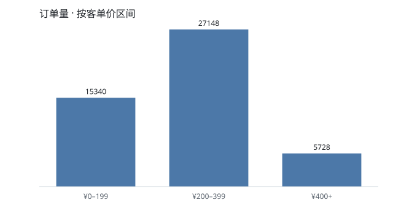
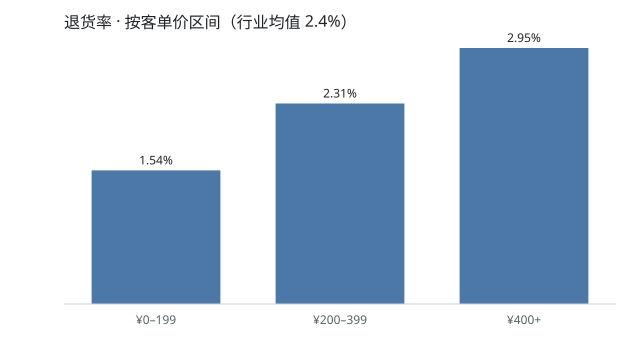
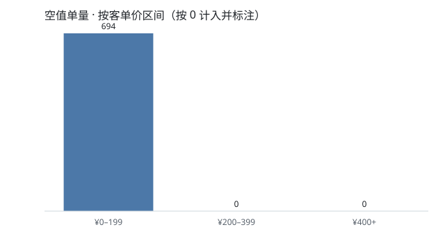
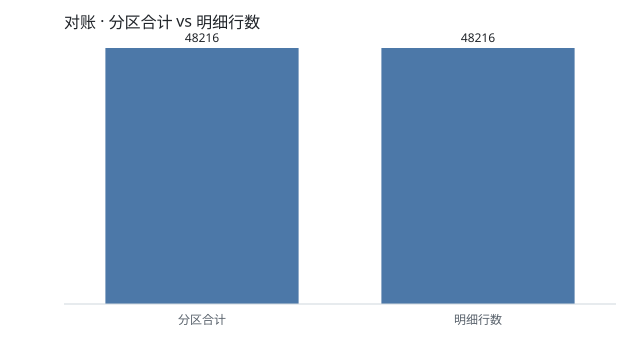
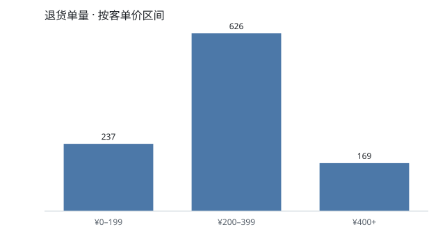
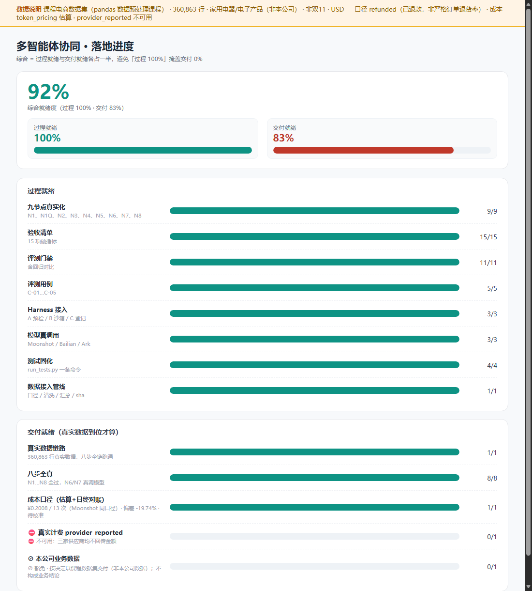
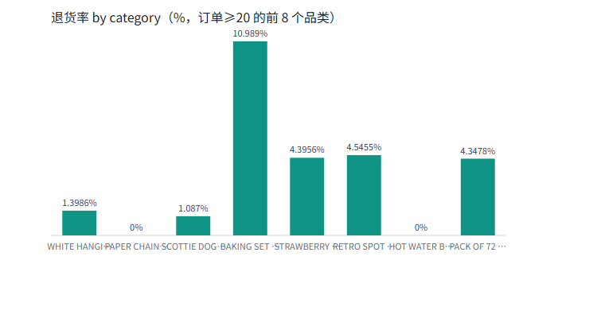

# 效果展示

这里放的是**真跑出来的东西**，不是示意图。数据来自一份公开课程电商数据集（36 万订单），
链路上 N2/N3/N4/N5/N8 是确定性脚本、N6/N7 走真模型网关，每个数字都能回溯到 `real/out/` 里的工件。

---

## 一、真数据全链跑完：36 万订单 / GMV 8999 万美元

`real/out/final_report.md` 的开头：

| 指标 | 数值 |
|---|---|
| 订单数 | 360,863 |
| GMV | $89,993,969.58 |
| 客单价 AOV | $249.39 |
| 退货单数 | 16,353 |
| 退款行占比 | 4.53% |

报告里同时钉死了口径（**这些字段缺一个就拒绝出报告**）：

- **币种**：USD，金额不跨币种换算
- **数据源**：`课程电商数据集_退款.csv` · sha256 `9b10c5af388b1c52…` · 360,863 行
- **退货口径**：已退款（退款行占比 = 已退款订单行 / 订单行，不是订单退货率）
- **时间范围**：2023-01-05 04:06 → 2023-11-21 10:10

品类分布（节选，按 GMV 排）：

| 品类 | 订单 | GMV | 退款行占比 |
|---|---|---|---|
| 电子产品-智能手机 | 85,647 | $34,481,795.16 | 6.85% |
| 电脑-笔记本 | 21,642 | $12,465,144.88 | 0.75% |
| 电子产品-视频-电视 | 14,822 | $7,389,536.40 | 6.85% |
| 家用电器-厨房-冰箱 | 16,938 | $7,211,193.27 | 0.66% |
| 家用电器-厨房-洗衣机 | 12,092 | $4,095,520.26 | 1.48% |

注意「服装-手套」：1,662 单，GMV 只有 $644,770，**退款行占比 58.72%** ——
这种小体量高退货的品类，是汇总数字里最先被淹掉、也最该被单独拎出来的信号。
这也正是 P3 结构化数据执行器存在的意义：分组统计 48,216 行、3 个客单价区间，对账差额 0。

## 二、Kimi 出的图（真渲染，不是模型说"应该能渲染"）

> N5 一审里的沙箱会**真渲染**这 5 个 SVG（5/5 必须过），而不是让模型口头确认。
> 空值按 0 计入并单独标注；`chart_value_lock=true`，Kimi 拿不到这个工件就拒绝派单。

## 三、沙箱证伪：数字不是模型"算"的

`real/out/execution_evidence.json` 记的是脚本跑出来的事实，模型只负责判读：

- 编译 PASS
- 单测 12/12
- SVG 渲染 5/5
- 数据脚本复算与 `structured_data.json` 对账差额 **0**
- 空值边界：真运行时复现异常，作为打回的确定性证据

原则一句话：**脚本产事实，模型判事实**。沙箱用后销毁，与密钥、控制面隔离。

## 四、成本台账与审计

`cohort/ledger.jsonl`（按调用点归因）和 `cohort/run_log.jsonl`（append-only 审计，52 条起）是这条链路的黑匣子：

- 每次模型调用记 tokens / 延迟 / 估算费用，按角色分摊
- 督办拦截、硬垂询、两级并行、三级审核的顺序都能在流水里查到
- 审计只追加不修改，事后能完整重放一次运行

## 五、评测与验收

评测（`eval/judge_report.json`）用锁定裁判跑：

| 项 | 值 |
|---|---|
| 分数 | 5 / 5 |
| faithfulness | high |
| relevance | high |
| 裁判模型 | `qwen-plus`（已锁定版本） |
| rubric | `rubric-v1.6-lock` |
| temperature | 0.3 |
| 本次成本 | 757 tokens / 951ms |

15 项验收清单逐条核验（`python acceptance.py`）：9/9 节点 DELIVERED、上下文完整度 100% 且截断 0、
执行并行 3/3、入口并行 2/2、三级审核链无第四审、深度校验 4 轮且异构检出 ≥ 1 处、
质量门禁打回 2 次后联合复审 PASS、注入载荷 1/1 隔离且事实零裁剪、评测 5/5 用例 + 7/7 硬门禁无劣化。

## 六、能看出来这套东西值在哪

1. **数字可信**：所有统计量出自确定性脚本，模型只判读，不算数。
2. **审核真能打回**：同源自查 + 异厂复核 + 沙箱证伪，三道不是走过场；质量门禁真打回过 2 次。
3. **成本看得见**：每次调用都记在台账上，按角色归因，不靠感觉估。
4. **可回退**：六个布尔位关掉即回到 v1.5，主链时序一点不动。

> 想看每张图怎么来的，直接翻 `real/out/`；想重跑，按 [使用说明.md](使用说明.md) 第二节走。
